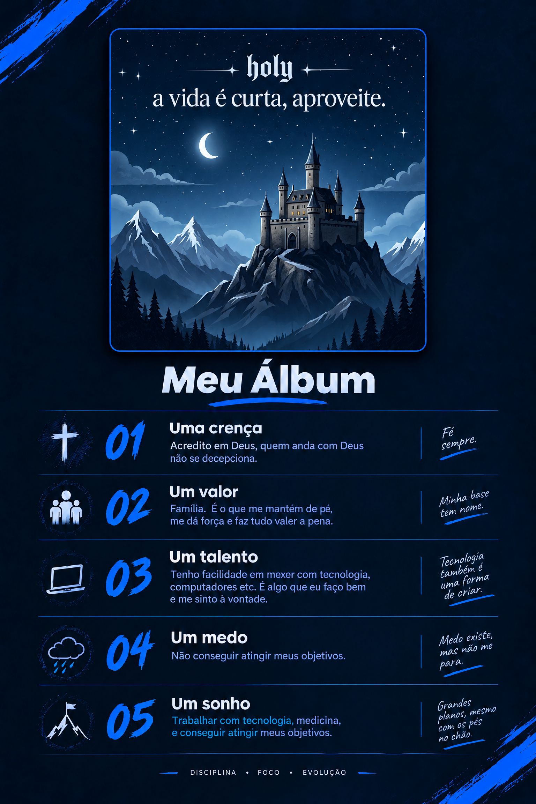

# 🌙 Holy — A vida é curta, aproveite.

Capa do meu álbum autoral **Holy**, criada como projeto visual do meu portfólio.

<p align="center">
  
</p>

## 📖 Sobre o projeto

O álbum **Holy** é um projeto pessoal. A capa mostra um castelo sobre uma montanha, numa noite estrelada com lua crescente, e traz a frase que dá nome ao conceito: **"a vida é curta, aproveite."**

A arte completa organiza o álbum em cinco faixas, cada uma representando um lado meu:

| Faixa | Tema |
|:-----:|------|
| 01 | Uma crença |
| 02 | Um valor |
| 03 | Um talento |
| 04 | Um medo |
| 05 | Um sonho |

No rodapé da arte ficam as palavras que guiam o projeto: **Disciplina • Foco • Evolução**.

## 🎨 Identidade visual

- **Paleta:** azul-marinho profundo com detalhes em azul elétrico
- **Estilo:** dark fantasy, com céu estrelado, montanhas e castelo
- **Tipografia:** título em estilo gótico, textos em sans-serif e frases de apoio em letra manuscrita

## 📁 Estrutura do repositório

```
capa-album-holy/
├── album_versao2.png   # Arte final da capa (versão 2)
└── README.md           # Este arquivo
```

## 🔗 Links

- 🌐 [Portfólio](https://github.com/tulioom/portfolio)
- 👤 [Meu GitHub](https://github.com/tulioom)

## ✍️ Autor

**Túlio Abreu Mendes de Assis**
Técnico em Informática para Internet — Varginha, MG

---

<p align="center"><em>Disciplina • Foco • Evolução</em></p>
